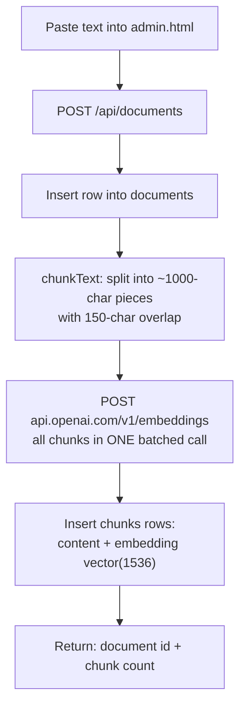
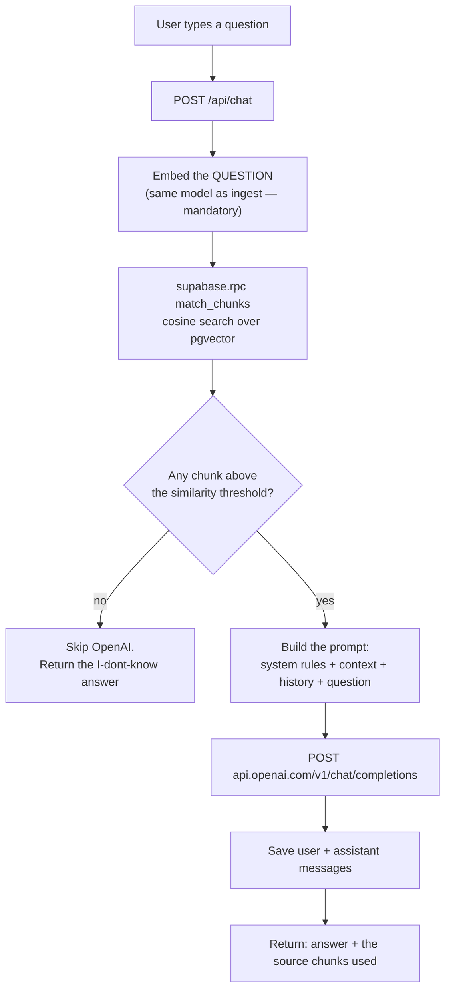

# Architecture — RAG Chatbot POC

> ### ⚠ Paths here describe the original build; the design does not change
>
> Migrated 2026-09-22 to a Turborepo monorepo (D-020, D-021). The data model in
> § 4, the two pipelines in § 3, the prompt in § 6 and the error policy in § 9
> are all still exactly what the code does — only the files moved. The current
> layout is in § 7 below and in [`CLAUDE.md`](./CLAUDE.md); the move itself is
> [`plan/steps.md`](./plan/steps.md).

This document is the design. It is written so that you can build the whole thing
from it without guessing. Read `techstack.md` first for what the pieces are and
`decisions.md` for why.

---

## 1. What RAG actually is

The whole idea in one paragraph, because everything below is just plumbing for it:

> A language model can only answer from (a) what it memorised during training and
> (b) what you put in the prompt. Your knowledge base is not in (a), so the job is
> to get the *relevant part* of it into (b). You cannot paste everything — prompts
> have a size limit and cost money per token. So you pre-compute a numeric
> "meaning fingerprint" (an **embedding**) for every chunk of your documents,
> compute one for the user's question, find the chunks whose fingerprints are
> closest, and paste **only those** into the prompt.

**Retrieval-Augmented Generation = search, then prompt.** The "AI magic" is
entirely in two ordinary HTTP calls; the interesting engineering is in the search.

### Why embeddings instead of keyword search

An embedding is an array of 1536 floating-point numbers produced by a model. Two
texts that *mean* similar things get arrays that point in a similar direction,
even with no words in common. "How do I get my money back?" and "Refund policy"
share zero keywords but sit close together in embedding space. Closeness is
measured with **cosine distance** — the angle between the two arrays.

`pgvector` gives Postgres a `vector` column type and the `<=>` operator, which
computes exactly that distance inside the database.

---

## 2. System overview

```
┌─────────────────────────────────────────────────────────┐
│  Browser  (native HTML + JS, no build step)             │
│                                                          │
│   public/index.html  ── chat UI                          │
│   public/admin.html  ── knowledge base manager           │
└───────────────────────────┬─────────────────────────────┘
                            │  fetch()  JSON over http://localhost:3000
                            ▼
┌─────────────────────────────────────────────────────────┐
│  Express server  (Node 20, server.js + src/*.js)         │
│                                                          │
│   • serves the two static pages                          │
│   • owns ALL secrets (OpenAI key, Supabase keys)         │
│   • runs the ingest pipeline and the query pipeline      │
└──────────┬──────────────────────────────┬───────────────┘
           │                              │
           │ HTTPS                        │ HTTPS
           ▼                              ▼
┌────────────────────────┐   ┌────────────────────────────┐
│  OpenAI API            │   │  Supabase (Postgres)       │
│  /v1/embeddings        │   │  documents                 │
│  /v1/chat/completions  │   │  chunks (+ vector column)  │
└────────────────────────┘   │  match_chunks() SQL fn     │
                             └────────────────────────────┘
```

**The browser never talks to OpenAI or Supabase directly.** Everything goes
through Express. That is not ceremony — it is the only thing keeping your API
key out of the page source (see `risks.md` § R-1).

---

## 3. The two pipelines

Everything the system does is one of these two flows. Learn these and you know
the project.

> ⚠️ **These diagrams are the original MVP design, and the build has moved on.**
> The implemented flow adds query rewriting before retrieval (D-016), a second
> keyword search fused with the vector one (D-015), and streaming delivery
> (D-019). For the flow **as built**, with the file and function behind each
> step, see [`flow.md`](./flow.md). The two pipelines below are still the right
> mental model — they are just missing three steps.

### 3.1 Ingest pipeline (once per document, on the admin page)



**Chunking** is the step most people never look at, and it decides retrieval
quality more than the model does. Two knobs:

- **Chunk size (~1000 characters).** Too small and a chunk loses the context that
  makes it meaningful. Too large and its embedding becomes an average of several
  topics, matching nothing well.
- **Overlap (~150 characters).** Each chunk repeats the tail of the previous one,
  so a sentence that straddles a boundary still appears whole somewhere.

Both live in one place as named constants. Changing them, re-ingesting, and
watching retrieval change is one of the more instructive things you can do here.

### 3.2 Query pipeline (every message, on the chat page)



**The single most important constraint in the whole project:** the question and
the documents must be embedded by **the same model**. Embeddings from different
models live in different coordinate spaces; comparing them produces numbers that
look fine and mean nothing. This is the classic silent RAG bug — the system
returns confident garbage and nothing errors.

---

## 4. Data model

Run this in the Supabase SQL editor. It is the complete schema.

```sql
-- 1. Enable pgvector. Supabase ships it; this just turns it on.
create extension if not exists vector;

-- 2. A source document, as pasted.
create table documents (
  id          bigint generated always as identity primary key,
  title       text        not null,
  source      text,                          -- optional: url, filename, note
  content     text        not null,          -- the full original text
  created_at  timestamptz not null default now()
);

-- 3. The searchable pieces. This is the table RAG actually reads.
create table chunks (
  id           bigint generated always as identity primary key,
  document_id  bigint       not null references documents(id) on delete cascade,
  chunk_index  int          not null,        -- position within the document
  content      text         not null,        -- the chunk text, shown as a source
  embedding    vector(1536) not null,        -- MUST match the embedding model size
  created_at   timestamptz  not null default now()
);

-- 4. Chat history, so a conversation can refer back to itself.
create table conversations (
  id          uuid primary key default gen_random_uuid(),
  created_at  timestamptz not null default now()
);

create table messages (
  id               bigint generated always as identity primary key,
  conversation_id  uuid        not null references conversations(id) on delete cascade,
  role             text        not null check (role in ('user', 'assistant')),
  content          text        not null,
  created_at       timestamptz not null default now()
);

-- 5. Indexes.
create index chunks_document_id_idx    on chunks (document_id);
create index messages_conversation_idx on messages (conversation_id, created_at);

-- The vector index. HNSW is the current pgvector recommendation: it can be
-- built on an empty table, unlike ivfflat which needs data to train on first.
create index chunks_embedding_idx
  on chunks using hnsw (embedding vector_cosine_ops);
```

> ⚠️ **`vector(1536)` is tied to the embedding model.** `text-embedding-3-small`
> outputs 1536 numbers. If you switch models, the column dimension must change
> *and every existing embedding must be regenerated* — old vectors are not
> convertible. See `decisions.md` D-004.

> ⚠️ **Row Level Security.** Supabase enables RLS on tables created through the
> dashboard's table editor, but a plain `create table` in the SQL editor does
> not. The POC's server uses the `service_role` key, which bypasses RLS anyway,
> so this will not block you — but it means the tables are unprotected if the
> anon key is ever exposed. See `risks.md` § R-2.

### The similarity search function

Vector search needs SQL, so it lives in a Postgres function and is called from
Node with `.rpc()`.

```sql
create or replace function match_chunks (
  query_embedding vector(1536),
  match_count     int   default 5,
  min_similarity  float default 0.3
)
returns table (
  id          bigint,
  document_id bigint,
  content     text,
  similarity  float
)
language sql stable
as $$
  select
    c.id,
    c.document_id,
    c.content,
    1 - (c.embedding <=> query_embedding) as similarity
  from chunks c
  where 1 - (c.embedding <=> query_embedding) >= min_similarity
  order by c.embedding <=> query_embedding   -- ascending distance = most similar first
  limit match_count;
$$;
```

Reading the operators:

- `<=>` is pgvector's **cosine distance**: `0` = identical direction, `2` = opposite.
- `1 - distance` converts it to a **similarity** score in roughly `0..1`, the more
  intuitive direction (higher = better), and what the UI displays.
- Ordering by **distance ascending** (not similarity descending) is what lets
  Postgres use the HNSW index. Getting this backwards silently disables the index
  and forces a full table scan — correct results, quietly wrong performance.
- `min_similarity` is the "do I actually know this?" gate. Below it the system
  refuses to answer rather than guessing — see § 6.

---

## 5. API surface

All JSON. All served from `http://localhost:3000`.

| Method | Route | Body / params | Returns | Used by |
|---|---|---|---|---|
| `GET` | `/` | — | `apps/web/app/page.tsx` | browser |
| `GET` | `/admin` | — | `apps/web/app/admin/page.tsx` | browser |
| `POST` | `/api/documents` | `{ title, source?, content }` | `{ id, title, chunkCount }` | admin |
| `GET` | `/api/documents` | — | `[{ id, title, source, chunkCount, created_at }]` | admin |
| `DELETE` | `/api/documents/:id` | — | `{ deleted: true }` (chunks cascade) | admin |
| `POST` | `/api/chat` | `{ conversationId?, message }` | `{ conversationId, reply, sources[] }` | chat |
| `GET` | `/api/conversations/:id/messages` | — | `[{ role, content, created_at }]` | chat |

`sources[]` is `[{ id, documentId, documentTitle, content, similarity }]` — the
exact chunks that were pasted into the prompt. **Showing these in the UI is a
required feature, not a debug nicety:** it is the only way to see whether an
answer came from your data or from the model's imagination.

---

## 6. Prompt assembly

This is the part frameworks hide, so build it explicitly and keep it in one
readable function.

```js
const messages = [
  {
    role: 'system',
    content: [
      'You answer questions using ONLY the context below.',
      'If the context does not contain the answer, reply exactly:',
      '"I don\'t know based on the documents I have."',
      'Do not use outside knowledge. Do not guess.',
      '',
      '--- CONTEXT ---',
      chunks.map((c, i) => `[${i + 1}] ${c.content}`).join('\n\n'),
      '--- END CONTEXT ---'
    ].join('\n')
  },
  ...recentHistory,              // last ~6 messages, oldest first
  { role: 'user', content: question }
];
```

Three things worth understanding here:

1. **The context is just text in the prompt.** There is no special "knowledge
   base" channel to the model. The retrieved chunks are pasted in as characters,
   exactly as shown. That is the entire trick.
2. **The instruction to refuse is doing real work.** Without it, the model happily
   answers from training data and you cannot tell the two apart.
3. **History is capped.** Every past message is re-sent and re-billed on every
   request. Unbounded history is how a cheap chatbot becomes an expensive one —
   see `costs.md`.

**Belt and braces:** when `match_chunks` returns nothing above the threshold, do
not call OpenAI at all — return the "I don't know" string directly. It is faster,
free, and removes any chance of the model ignoring its instructions.

---

## 7. File layout

```
rag-chatbot-poc/
├── .env                    # secrets — gitignored, never committed
├── .env.example            # the same keys with empty values, committed
├── turbo.json              # task graph; globalEnv names every secret
├── apps/web/               # Next.js — both screens and all six routes
│   ├── app/page.tsx            # S-1 chat
│   ├── app/admin/page.tsx      # S-2 knowledge base
│   ├── app/api/**/route.ts     # the six endpoints
│   └── lib/                    # route.ts, env.ts, limits.ts, schemas.ts
└── packages/
    ├── chunker/            # chunkText() — pure, zero dependencies
    ├── openai/             # embed() + chat() + chatStream() — raw fetch
    ├── db/                 # the client, the types, and sql/
    └── rag/                # ingestDocument() + answerQuestion()
```

The original build was 500–700 lines. The port did not add features, and the
line count is dominated by the same code with types on it. If it heads a long
way past that, something is being built that `mvp.md` § Out of scope says not
to build.

### What each module owns

| Package / file | Responsibility | Must NOT contain |
|---|---|---|
| `@rag/openai` | Three `fetch` calls. Reads `OPENAI_API_KEY`. Throws `OpenAIError` carrying the upstream status. | Any knowledge of chunks, documents or prompts |
| `@rag/db` | One client, the generated types, `sql/`, and the `server-only` guard | Query logic |
| `@rag/chunker` | Pure text → array of strings. No async, **no dependencies**. | Any I/O or API call |
| `@rag/pipeline` | The two pipelines from § 3, orchestrating the packages above | HTTP handling, `req`/`res` |
| `apps/web/app/api` | Six Route Handlers: validation, and the response shape | Business logic |
| `apps/web/lib/route.ts` | `withRoute()` — the ONE error → status map | Anything route-specific |

The point of the split is unchanged, and is now enforced rather than agreed:
`@rag/chunker` declares no dependencies, so it can be read with no network in
sight; `@rag/pipeline` reads top-to-bottom as the pipeline diagram; and
`@rag/db` is the only package that may import `server-only`, which is what
keeps the service-role key out of the browser bundle.

---

## 8. Environment variables

```ini
# .env — never commit this file
OPENAI_API_KEY=sk-...
OPENAI_CHAT_MODEL=gpt-4o-mini
OPENAI_EMBEDDING_MODEL=text-embedding-3-small

SUPABASE_URL=https://xxxxxxxx.supabase.co
SUPABASE_SERVICE_ROLE_KEY=eyJ...

PORT=3000
```

Where to find the Supabase values: Supabase dashboard → your project →
**Project Settings → API**. Use the **`service_role`** key, not the `anon` key —
the server needs to write and RLS is not configured in the POC (D-006).

**Fail fast:** on startup, check every variable is present and `process.exit(1)`
with a clear message naming the missing one. A missing key should be a one-line
error at boot, not a confusing 401 twenty minutes later.

---

## 9. Error handling

Minimal, but never silent. Each of these gets a specific, readable message:

| Failure | Handling |
|---|---|
| Missing env var | Exit at startup, naming the variable |
| OpenAI 401 | "OpenAI rejected the API key" |
| OpenAI 429 | "Out of OpenAI credits or rate limited" — the most likely real failure |
| OpenAI 5xx / network | Surface it; no retry logic in the MVP |
| Supabase error | Return `error.message` as-is — it is usually accurate |
| Empty retrieval | Not an error. The "I don't know" path (§ 6) |
| Empty or oversized input | 400, saying what was wrong |

No retry loops, no exponential backoff, no circuit breakers. They would obscure
exactly the failures you want to see while learning.
