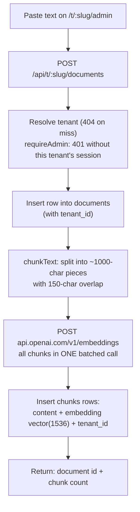
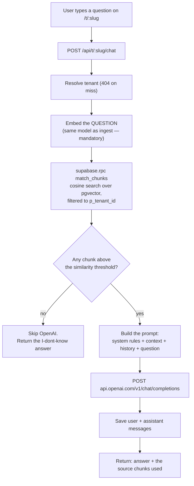

# Architecture — RAG Chatbot POC

> ### ⚠ Paths here describe the original build; the design does not change
>
> Migrated 2026-09-22 to a Turborepo monorepo (D-020, D-021). The data model in
> § 4, the two pipelines in § 3, the prompt in § 6 and the error policy in § 9
> are all still exactly what the code does — only the files moved. The current
> layout is in § 7 below and in [`CLAUDE.md`](./CLAUDE.md); the move itself is
> [`plan/steps.md`](./plan/steps.md).

This document is the design. It is written so that you can build the whole thing
from it without guessing. Read `techstack.md` first for what the pieces are and
`decisions.md` for why.

---

## 1. What RAG actually is

The whole idea in one paragraph, because everything below is just plumbing for it:

> A language model can only answer from (a) what it memorised during training and
> (b) what you put in the prompt. Your knowledge base is not in (a), so the job is
> to get the *relevant part* of it into (b). You cannot paste everything — prompts
> have a size limit and cost money per token. So you pre-compute a numeric
> "meaning fingerprint" (an **embedding**) for every chunk of your documents,
> compute one for the user's question, find the chunks whose fingerprints are
> closest, and paste **only those** into the prompt.

**Retrieval-Augmented Generation = search, then prompt.** The "AI magic" is
entirely in two ordinary HTTP calls; the interesting engineering is in the search.

### Why embeddings instead of keyword search

An embedding is an array of 1536 floating-point numbers produced by a model. Two
texts that *mean* similar things get arrays that point in a similar direction,
even with no words in common. "How do I get my money back?" and "Refund policy"
share zero keywords but sit close together in embedding space. Closeness is
measured with **cosine distance** — the angle between the two arrays.

`pgvector` gives Postgres a `vector` column type and the `<=>` operator, which
computes exactly that distance inside the database.

---

## 2. System overview

```
┌─────────────────────────────────────────────────────────┐
│  Browser  (React Client Components)                      │
│                                                          │
│   /t/<slug>        chat-screen.tsx   — S-1 chat          │
│   /t/<slug>/admin  admin-screen.tsx  — S-2 knowledge base│
│   (the slug arrives as a prop from the server)           │
└───────────────────────────┬─────────────────────────────┘
                            │  fetch()  JSON / SSE to /api/t/<slug>/…
                            ▼
┌─────────────────────────────────────────────────────────┐
│  Next.js server  (App Router, apps/web)                  │
│                                                          │
│   • Server Component pages resolve the tenant (404 miss) │
│   • Route Handlers: withTenantRoute → withRoute          │
│   • owns ALL secrets (OpenAI key, service_role key,      │
│     ADMIN_COOKIE_SECRET); @rag/db is server-only         │
│   • @rag/pipeline runs ingest and query, per tenant      │
└──────────┬──────────────────────────────┬───────────────┘
           │                              │
           │ HTTPS                        │ HTTPS
           ▼                              ▼
┌────────────────────────┐   ┌────────────────────────────┐
│  OpenAI API            │   │  Supabase (Postgres)       │
│  /v1/embeddings        │   │  tenants                   │
│  /v1/chat/completions  │   │  documents · chunks        │
└────────────────────────┘   │  conversations · messages  │
                             │  match_chunks[_fts]() —    │
                             │  tenant-scoped SQL fns     │
                             └────────────────────────────┘
```

**The browser never talks to OpenAI or Supabase directly.** Everything goes
through the Next.js server. That is not ceremony: it is the only thing keeping
the API key and the `service_role` key out of the page source (see `risks.md`
§ R-1, R-2). `@rag/db` imports `server-only`, so a Client Component that tried
to import it would fail the build.

**Every request names its tenant in the URL**, and nothing picks one for it.
The slug is resolved once, on the server, into a `TenantContext` that every
pipeline function requires (D-026, D-027).

---

## 3. The two pipelines

Everything the system does is one of these two flows. Learn these and you know
the project.

> ⚠️ **These diagrams are the original MVP design, and the build has moved on.**
> The implemented flow adds query rewriting before retrieval (D-016), a second
> keyword search fused with the vector one (D-015), and streaming delivery
> (D-019). For the flow **as built**, with the file and function behind each
> step, see [`flow.md`](./flow.md). The two pipelines below are still the right
> mental model — they are just missing three steps.
>
> **Tenancy (2026-09-23)** adds one step in front of both: resolve the slug to a
> tenant, or 404. Every step after it is scoped to that tenant.

### 3.1 Ingest pipeline (once per document, on the admin page)



**Chunking** is the step most people never look at, and it decides retrieval
quality more than the model does. Two knobs:

- **Chunk size (~1000 characters).** Too small and a chunk loses the context that
  makes it meaningful. Too large and its embedding becomes an average of several
  topics, matching nothing well.
- **Overlap (~150 characters).** Each chunk repeats the tail of the previous one,
  so a sentence that straddles a boundary still appears whole somewhere.

Both live in one place as named constants. Changing them, re-ingesting, and
watching retrieval change is one of the more instructive things you can do here.

### 3.2 Query pipeline (every message, on the chat page)



**The single most important constraint in the whole project:** the question and
the documents must be embedded by **the same model**. Embeddings from different
models live in different coordinate spaces; comparing them produces numbers that
look fine and mean nothing. This is the classic silent RAG bug — the system
returns confident garbage and nothing errors.

---

## 4. Data model

The schema is **three files, run in order** in the Supabase SQL editor, all in
`packages/db/sql/`:

1. `schema.sql` — the four original tables and the first `match_chunks` (below).
2. `schema-hybrid.sql` — the full-text index and `match_chunks_fts` (D-015).
3. `schema-tenancy.sql` — the `tenants` table, `tenant_id` everywhere, and the
   tenant-scoped versions of both search functions. It is idempotent and
   describes the FINAL state: its last step drops the pre-tenancy function
   signatures that files 1 and 2 create. See "Tenancy" below.

⚠ **The order is also the recovery rule.** Re-running file 1 or 2 against a
tenant database recreates the unscoped search functions with `create or
replace`, and they would search every tenant, with no error. Always follow
either one with file 3.

The block below is `schema.sql`, the shape everything else builds on:

```sql
-- 1. Enable pgvector. Supabase ships it; this just turns it on.
create extension if not exists vector;

-- 2. A source document, as pasted.
create table documents (
  id          bigint generated always as identity primary key,
  title       text        not null,
  source      text,                          -- optional: url, filename, note
  content     text        not null,          -- the full original text
  created_at  timestamptz not null default now()
);

-- 3. The searchable pieces. This is the table RAG actually reads.
create table chunks (
  id           bigint generated always as identity primary key,
  document_id  bigint       not null references documents(id) on delete cascade,
  chunk_index  int          not null,        -- position within the document
  content      text         not null,        -- the chunk text, shown as a source
  embedding    vector(1536) not null,        -- MUST match the embedding model size
  created_at   timestamptz  not null default now()
);

-- 4. Chat history, so a conversation can refer back to itself.
create table conversations (
  id          uuid primary key default gen_random_uuid(),
  created_at  timestamptz not null default now()
);

create table messages (
  id               bigint generated always as identity primary key,
  conversation_id  uuid        not null references conversations(id) on delete cascade,
  role             text        not null check (role in ('user', 'assistant')),
  content          text        not null,
  created_at       timestamptz not null default now()
);

-- 5. Indexes.
create index chunks_document_id_idx    on chunks (document_id);
create index messages_conversation_idx on messages (conversation_id, created_at);

-- The vector index. HNSW is the current pgvector recommendation: it can be
-- built on an empty table, unlike ivfflat which needs data to train on first.
create index chunks_embedding_idx
  on chunks using hnsw (embedding vector_cosine_ops);
```

> ⚠️ **`vector(1536)` is tied to the embedding model.** `text-embedding-3-small`
> outputs 1536 numbers. If you switch models, the column dimension must change
> *and every existing embedding must be regenerated* — old vectors are not
> convertible. See `decisions.md` D-004.

> ⚠️ **Row Level Security.** Supabase enables RLS on tables created through the
> dashboard's table editor, but a plain `create table` in the SQL editor does
> not. The POC's server uses the `service_role` key, which bypasses RLS anyway,
> so this will not block you — but it means the tables are unprotected if the
> anon key is ever exposed. See `risks.md` § R-2.

### Tenancy: five tables, one `tenant_id` filter

`schema-tenancy.sql` turns one knowledge base into many. It uses shared tables
with a `tenant_id` column, not schema-per-tenant (D-025).

```sql
create table if not exists tenants (
  id              bigint generated always as identity primary key,
  slug            text        not null unique,   -- the /t/<slug> segment
  business_name   text        not null,          -- "Northwind Labs"
  assistant_name  text        not null,          -- "Nora"
  logo_url        text,                          -- https only, validated on write
  banner_url      text,
  theme           jsonb       not null default '{}'::jsonb,
  admin_key_hash  text,                          -- scrypt; null = nobody can admin it
  created_at      timestamptz not null default now(),
  constraint tenants_slug_shape check (slug ~ '^[a-z0-9][a-z0-9-]{1,30}[a-z0-9]$'),
  constraint tenants_slug_reserved check (
    slug not in ('api','admin','t','_next','static','new','login','health')
  )
);

-- On documents, chunks, conversations and messages. Backfilled, then NOT NULL,
-- with NO default: an insert that does not name its tenant fails.
alter table documents add column if not exists tenant_id bigint references tenants(id) on delete cascade;
alter table documents alter column tenant_id set not null;
-- …likewise for chunks, conversations, messages.

-- The composite foreign keys. chunks.tenant_id duplicates documents.tenant_id on
-- purpose (the search functions scan chunks alone), and this makes the copy
-- impossible to get wrong: a chunk whose tenant disagrees with its document's
-- fails to insert. The same holds for a message and its conversation.
alter table documents     add constraint documents_id_tenant_key     unique (id, tenant_id);
alter table conversations add constraint conversations_id_tenant_key unique (id, tenant_id);
alter table chunks   add constraint chunks_document_tenant_fk
  foreign key (document_id, tenant_id) references documents (id, tenant_id) on delete cascade;
alter table messages add constraint messages_conversation_tenant_fk
  foreign key (conversation_id, tenant_id) references conversations (id, tenant_id) on delete cascade;

create index if not exists documents_tenant_idx     on documents (tenant_id, created_at desc);
create index if not exists chunks_tenant_idx        on chunks (tenant_id);
create index if not exists messages_tenant_conv_idx on messages (tenant_id, conversation_id, id);
```

(The real file wraps each constraint in an `if not exists` check so it can be
re-run safely.) The HNSW index is unchanged: one global graph over every tenant.

⚠️ **The server uses `service_role`, which bypasses RLS.** After tenancy, the
only thing between two tenants on a READ is a `tenant_id = …` filter, in
application code and inside the two functions below. The composite FKs guard
writes; reads are guarded only by filters someone remembered to write (R-11).

A side effect worth knowing about: with two foreign keys from `chunks` to
`documents`, PostgREST will not pick one for an embedded select. So
`listDocuments()` names it, as `chunks!chunks_document_tenant_fk(count)`.

### The similarity search function

Vector search needs SQL, so it lives in a Postgres function and is called from
Node with `.rpc()`. This is the tenant-scoped version from `schema-tenancy.sql`,
the only one that still exists:

```sql
create or replace function match_chunks (
  query_embedding vector(1536),
  p_tenant_id     bigint,                    -- NO default (D-027)
  match_count     int   default 5,
  min_similarity  float default 0.3
)
returns table (
  id          bigint,
  document_id bigint,
  content     text,
  similarity  float
)
language sql stable
set hnsw.iterative_scan = 'strict_order'
as $$
  select
    c.id,
    c.document_id,
    c.content,
    1 - (c.embedding <=> query_embedding) as similarity
  from chunks c
  where c.tenant_id = p_tenant_id
    and 1 - (c.embedding <=> query_embedding) >= min_similarity
  order by c.embedding <=> query_embedding   -- ascending distance = most similar first
  limit match_count;
$$;
```

Its keyword twin, `match_chunks_fts(query_text, query_embedding, p_tenant_id,
match_count)`, carries the same `c.tenant_id = p_tenant_id` filter.

**Why the tenant filter is inside the function and not in the caller.** Here
the filter runs BEFORE the `limit`, so another tenant's chunk never takes up
one of the candidate slots. Filtering afterwards, in TypeScript, would let ten
slots fill up with the wrong tenant and fuse down to zero results.

**Why `p_tenant_id` has no default.** A defaulted tenant parameter is a
function that quietly searches the wrong tenant when a caller forgets an
argument. Without a default, a forgotten tenant is an error.

**Why `iterative_scan`.** HNSW has no idea what a tenant is: it walks the graph
and the tenant filter is applied afterwards. For a tenant large enough that the
planner picks HNSW, a short walk can find only other tenants' chunks and
return zero rows, which is a silent false refusal. Tenancy Phase 2 reproduced
exactly that: villa got 0 rows at `ef_search` 2, and 5 rows with iterative
scan. `strict_order` keeps most-similar-first ordering, which `relaxed_order`
does not promise. At today's size the planner instead reads the tenant through
`chunks_tenant_idx` and sorts exactly. See `notes.md` § "Tenancy Phase 2" and
`risks.md` R-10.

Reading the operators:

- `<=>` is pgvector's **cosine distance**: `0` = identical direction, `2` = opposite.
- `1 - distance` converts it to a **similarity** score in roughly `0..1`, the more
  intuitive direction (higher = better), and what the UI displays.
- Ordering by **distance ascending** (not similarity descending) is what lets
  Postgres use the HNSW index. Getting this backwards silently disables the index
  and forces a full table scan — correct results, quietly wrong performance.
- `min_similarity` is the "do I actually know this?" gate. Below it the system
  refuses to answer rather than guessing — see § 6.

### Bookings: four more tables (bookings Phase 1, `schema-bookings.sql`)

Only tenants with the **bookings** application use these (D-033). Today that
is villa. Each one carries `tenant_id`, and each child points at its parent
with a composite FK, the same pattern as `chunks → documents`.

| Table | What a row is | The part that matters |
|---|---|---|
| `tenant_applications` | "this tenant has this application" | primary key `(tenant_id, application_key)`. A row means on. `config.timezone` is required and validated by a trigger (`22023` for an unknown name) |
| `units` | a thing that can be booked | villa has one, `Whole property`. A hotel would have one per room |
| `slots` | a named time window | `start_time` (wall clock, tenant's timezone) and `duration`, which may cross midnight. Villa: Day Tour 08:00+9h, Overnight 14:00+22h, 22-Hour Whole Day 08:00+22h |
| `bookings` | one booking, with guest data | `during tstzrange '[)'` is set by the `bookings_compute_during` trigger, never by the client. `bookings_no_overlap` excludes two live bookings of one unit whose `during` overlaps (`23P01`). Cancelled rows free their span |

`check_availability(p_tenant_id, p_from, p_to)` returns one row per (date, unit,
slot) as `open` or `taken`, using the same `&&` test as the constraint, and **no
guest data**: whatever it returns reaches a prompt (D-037). Like
`match_chunks`, `p_tenant_id` has no default. The details and the measured
ranges are in D-034.

---

## 5. API surface

All JSON. All served from `http://localhost:3000`. **Every route names its
tenant in the path**, as `/t/<slug>` for pages and `/api/t/<slug>/…` for the API
(D-026). There is no default tenant and no redirect: the old un-prefixed
`/api/chat` and `/admin` are 404s. An unknown slug is a 404, `No workspace
named "<slug>"`.

| Method | Route | Body / params | Returns | Access |
|---|---|---|---|---|
| `GET` | `/` | — | a static page; no tenant list, no redirect | public |
| `GET` | `/t/<slug>` | — | S-1 chat | public |
| `GET` | `/t/<slug>/admin` | — | S-2 knowledge base; a login form until a session exists | public page, admin data |
| `POST` | `/api/t/<slug>/chat` | `{ conversationId?, message }` | `{ conversationId, reply, sources[], searchQuery, toolCalls[] }`, or SSE (`meta`, `tool`, `delta`, `done`, `error`) with `Accept: text/event-stream` | **open** |
| `GET` | `/api/t/<slug>/conversations/:id/messages` | — | `[{ role, content, created_at }]`, or 404 if not this tenant's | **open** |
| `POST` | `/api/t/<slug>/admin/session` | `{ key }` | `{ admin: true }` and the session cookie | open (it is the login) |
| `GET` | `/api/t/<slug>/admin/session` | — | `{ admin: boolean }` | open |
| `DELETE` | `/api/t/<slug>/admin/session` | — | `{ admin: false }`; the cookie is cleared | open |
| `POST` | `/api/t/<slug>/documents` | `{ title, source?, content }` | `{ id, title, chunkCount }` | **admin** |
| `GET` | `/api/t/<slug>/documents` | — | `[{ id, title, source, chunkCount, created_at }]` | **admin** |
| `DELETE` | `/api/t/<slug>/documents/:id` | — | `{ deleted: true }` (chunks cascade) | **admin** |
| `GET` | `/api/t/<slug>/documents/:id/chunks` | — | `[{ id, chunk_index, content }]` | **admin** |
| `GET` | `/t/<slug>/admin/bookings` | — | S-3 bookings; 404 without the application | public page, admin data |
| `GET` | `/api/t/<slug>/bookings/setup` | — | `{ timezone, today, units[], slots[] }` | **admin** + app |
| `GET` | `/api/t/<slug>/bookings/availability` | `?from=YYYY-MM-DD&to=` (≤ 31 days) | `[{ date, unit, slot, status }]` | **admin** + app |
| `GET` | `/api/t/<slug>/bookings` | `?from=&to=` (≤ 92 days) | `[{ id, date, unit, slot, status, guestName, … }]` | **admin** + app |
| `POST` | `/api/t/<slug>/bookings` | `{ unitId, slotId, date, guestName, guestPhone?, guestCount?, notes? }` | the booking, `201`. `409` if the span is taken | **admin** + app |
| `DELETE` | `/api/t/<slug>/bookings/:id` | — | `{ cancelled: true }`; the row stays, as `cancelled` | **admin** + app |

**Admin** means `requireAdmin()` in `apps/web/lib/admin-auth.ts`: the request
must carry this tenant's session cookie. That is an HMAC-signed
`<slug>.<expiry>.<mac>`, httpOnly, SameSite=lax, with its path set to
`/api/t/<slug>`. Without one, the route answers `401 Admin login required`
(D-028). The chat stays open, because it is the product.

**+ app** means `requireApplication(tenant, 'bookings')` as well, which is a
`404` for a tenant without it. It runs after the admin check, so a stranger gets
the same `401` whether or not the tenant has bookings. The error map passes
`400`, `404` and `409` through for the app's own errors. An `OpenAIError`'s `400`
or `404` is still a `500`, because it means this server sent the bad request.

**Another tenant's id behaves exactly like a missing one.** A document id from
another tenant gives `[]` for its chunks and `404` on delete. A conversation id
from another tenant gives `404` for its transcript, and is ignored by chat,
which starts a new conversation. That way ids cannot be enumerated across
tenants.

`sources[]` is `[{ id, documentId, documentTitle, content, similarity, foundBy }]`,
the exact chunks that were pasted into the prompt. **Showing these in the UI is a
required feature, not a debug nicety:** it is the only way to see whether an
answer came from your data or from the model's imagination.

---

## 6. Prompt assembly

This is the part frameworks hide, so build it explicitly and keep it in one
readable function.

```js
const messages = [
  {
    role: 'system',
    content: [
      'You answer questions using ONLY the context below.',
      'If the context does not contain the answer, reply exactly:',
      '"I don\'t know based on the documents I have."',
      'Do not use outside knowledge. Do not guess.',
      '',
      '--- CONTEXT ---',
      chunks.map((c, i) => `[${i + 1}] ${c.content}`).join('\n\n'),
      '--- END CONTEXT ---'
    ].join('\n')
  },
  ...recentHistory,              // last ~6 messages, oldest first
  { role: 'user', content: question }
];
```

Three things worth understanding here:

1. **The context is just text in the prompt.** There is no special "knowledge
   base" channel to the model. The retrieved chunks are pasted in as characters,
   exactly as shown. That is the entire trick.
2. **The instruction to refuse is doing real work.** Without it, the model happily
   answers from training data and you cannot tell the two apart.
3. **History is capped.** Every past message is re-sent and re-billed on every
   request. Unbounded history is how a cheap chatbot becomes an expensive one —
   see `costs.md`.

**Belt and braces:** when `match_chunks` returns nothing above the threshold, do
not call OpenAI at all — return the "I don't know" string directly. It is faster,
free, and removes any chance of the model ignoring its instructions.

**With tools (bookings, 2026-09-24).** For a tenant that has tools, one more block
is appended **after** `--- END CONTEXT ---`: "A tool result is context too, and
every rule above applies to it", the availability rules, and today's date in
the tenant's timezone (D-036). The model may then ask for a tool call. The
pipeline runs it (`executeTool`), appends the request and the result as an
`assistant` message with `tool_calls` and a `tool` message, and asks again, up
to `MAX_TOOL_ROUNDS` (2). The result is pasted in as text, exactly like the
chunks: the model never touches the database. The belt-and-braces rule becomes
D-035. With zero chunks, the reply is kept only if a tool was called.
Otherwise it is the refusal. A tenant without tools still never reaches
OpenAI.

---

## 7. File layout

```
rag-chatbot-poc/
├── .env                    # secrets — gitignored, never committed
├── .env.example            # the same keys with empty values, committed
├── turbo.json              # task graph; globalEnv names every secret
├── apps/web/               # Next.js — both screens, every route
│   ├── app/page.tsx                    # static root: no tenant list, no redirect
│   ├── app/t/[tenant]/layout.tsx       # tenant theme (style prop) + tab title
│   ├── app/t/[tenant]/page.tsx         # S-1 chat (Server Component → ChatScreen)
│   ├── app/t/[tenant]/admin/page.tsx   # S-2 knowledge base (→ AdminScreen)
│   ├── app/t/[tenant]/not-found.tsx    # "No such workspace"
│   ├── app/api/t/[tenant]/**/route.ts  # the endpoints, incl. admin/session
│   ├── components/                     # chat-screen, admin-screen, brand-header, sources-panel
│   └── lib/                            # route, tenant, admin-auth, branding, env, limits, schemas, chat-stream
└── packages/
    ├── chunker/            # chunkText() — pure, zero dependencies
    ├── openai/             # embed() + chat() + chatStream() — raw fetch
    ├── db/                 # the client, the types, sql/, admin-key.ts; tools/verify.mjs, tools/tenant.mjs
    └── rag/                # the pipelines + tenant.ts; tools/prompt-eval, score-probe, isolation
```

The original build was 500–700 lines. The port did not add features, and the
line count is dominated by the same code with types on it. If it heads a long
way past that, something is being built that `mvp.md` § Out of scope says not
to build.

### What each module owns

| Package / file | Responsibility | Must NOT contain |
|---|---|---|
| `@rag/openai` | Three `fetch` calls. Reads `OPENAI_API_KEY`. Throws `OpenAIError` carrying the upstream status. | Any knowledge of chunks, documents or prompts |
| `@rag/db` | One client, the hand-written types, `sql/`, the `server-only` guard, and `admin-key.ts` (scrypt hash and verify for `tenants.admin_key_hash`) | Query logic |
| `@rag/db` `tools/tenant.mjs` | `tenant:add` / `tenant:key`: print a new admin key once, store only its hash | Any way to read a key back |
| `@rag/chunker` | Pure text → array of strings. No async, **no dependencies**. | Any I/O or API call |
| `@rag/pipeline` | The two pipelines from § 3, orchestrating the packages above. Every function that touches the database takes a required `TenantContext` first (D-027). | HTTP handling, `req`/`res`; any default tenant |
| `@rag/pipeline` `src/tenant.ts` | `loadTenant(slug)`: the one place a `tenants` row becomes a `TenantContext`, selecting four named columns | `admin_key_hash` |
| `@rag/pipeline` `tools/isolation.mjs` | 11 cross-tenant checks run through the pipeline (`pnpm --filter @rag/pipeline isolation`) | — |
| `apps/web/app/api/t/[tenant]` | Route Handlers: validation, and the response shape | Business logic |
| `apps/web/lib/route.ts` | `withRoute()`, the ONE error → status map | Anything route-specific |
| `apps/web/lib/tenant.ts` | `getTenant()` (cached) and `withTenantRoute()`: slug → `TenantContext`, 404 on a miss | A fallback tenant |
| `apps/web/lib/admin-auth.ts` | The session cookie (sign, read), `requireAdmin()`, `checkAdminKey()` | Plaintext keys, logging of keys |
| `apps/web/lib/branding.ts` | `loadBranding()` and `themeVars()`: a five-key colour allowlist, https-only image URLs | `dangerouslySetInnerHTML`, free-form CSS |
| `apps/web/components/*-screen.tsx` | The two Client Components. They get the tenant as props from a Server Component page, never from `window.location` | `@rag/db`, secrets |

The point of the split is unchanged, and is now enforced rather than agreed:
`@rag/chunker` declares no dependencies, so it can be read with no network in
sight; `@rag/pipeline` reads top-to-bottom as the pipeline diagram; and
`@rag/db` is the only package that may import `server-only`, which is what
keeps the service-role key out of the browser bundle.

---

## 8. Environment variables

```ini
# .env — never commit this file
OPENAI_API_KEY=sk-...
OPENAI_CHAT_MODEL=gpt-4o-mini
OPENAI_EMBEDDING_MODEL=text-embedding-3-small

SUPABASE_URL=https://xxxxxxxx.supabase.co
SUPABASE_SERVICE_ROLE_KEY=eyJ...

# Signs the per-tenant admin session cookie. ≥ 32 random characters.
# Rotating it logs every admin out. It is NOT an admin key.
ADMIN_COOKIE_SECRET=...

PORT=3000
```

Admin keys are not environment variables. There is one per tenant, issued by
`pnpm --filter @rag/db tenant:key -- <slug>` and stored only as a hash.

Where to find the Supabase values: Supabase dashboard → your project →
**Project Settings → API**. Use the **`service_role`** key, not the `anon` key —
the server needs to write and RLS is not configured in the POC (D-006).

**Fail fast:** `apps/web/lib/env.ts` checks every required variable (including
`ADMIN_COOKIE_SECRET`). It logs one line naming the missing ones at import, and
throws that same message on every request (D-023). A missing key should be a
one-line error, not a confusing 401 twenty minutes later.

---

## 9. Error handling

Minimal, but never silent. Each of these gets a specific, readable message:

| Failure | Handling |
|---|---|
| Missing env var | Exit at startup, naming the variable |
| OpenAI 401 | "OpenAI rejected the API key" |
| OpenAI 429 | "Out of OpenAI credits or rate limited" — the most likely real failure |
| OpenAI 5xx / network | Surface it; no retry logic in the MVP |
| Supabase error | Return `error.message` as-is — it is usually accurate |
| Empty retrieval | Not an error. The "I don't know" path (§ 6) |
| Empty or oversized input | 400, saying what was wrong |

No retry loops, no exponential backoff, no circuit breakers. They would obscure
exactly the failures you want to see while learning.
