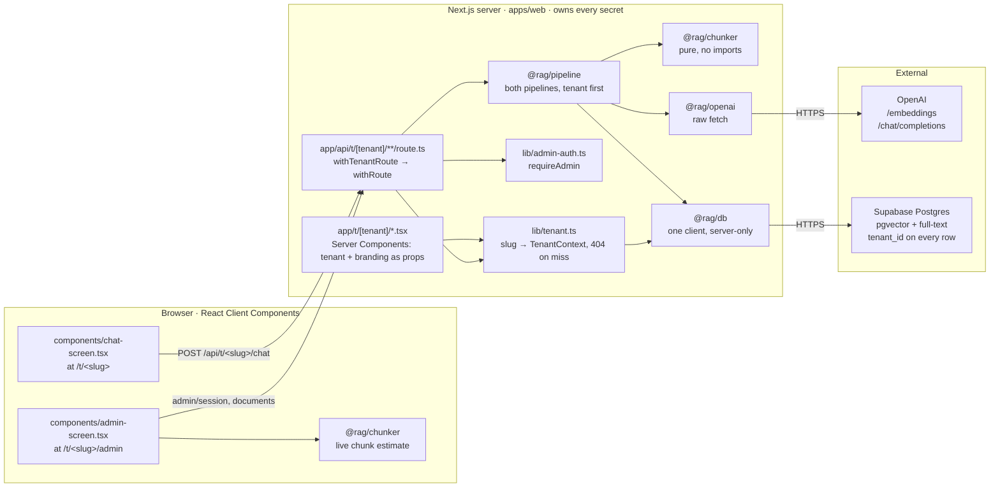
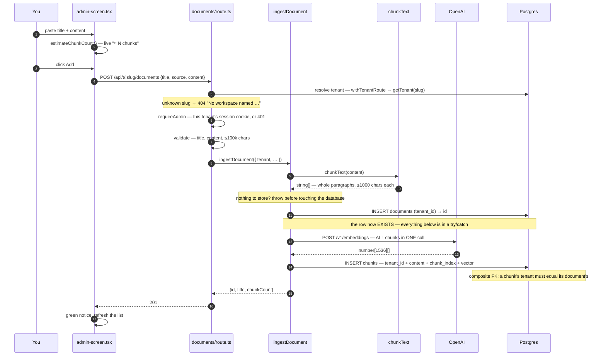
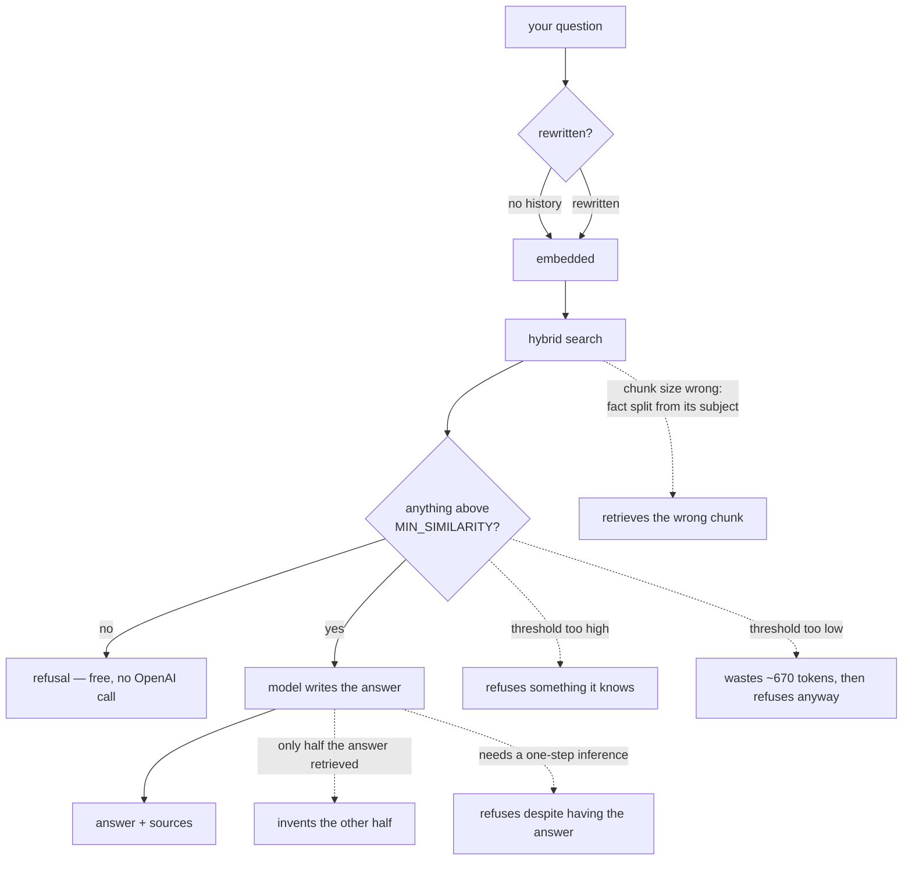

# Flow — how a request actually travels through this code

> ### Current as of tenancy (2026-09-23)
>
> The Express POC became a Next.js app on a Turborepo monorepo (D-020, D-021),
> and then became multi-tenant (`plan.md`, D-025…D-030). Every request now
> starts by **resolving a tenant**, and every step after that is scoped to it.
> The pipeline itself (rewrite, embed, two searches, fuse, prompt, stream) is
> unchanged.

> **What this file is.** `architecture.md` § 3 has the *original MVP design*.
> This file has the **flow as built**, including the five post-MVP additions
> (D-015 hybrid search, D-016 query rewriting, D-017 prompt wording, D-018
> paragraph-aware chunking, D-019 streaming).
>
> Every box names the file and function that does the work, so you can read the
> diagram with the source open beside it.
>
> Last updated: 2026-09-23

---

## 1. The big picture

Three processes. The browser never talks to OpenAI or Supabase — that is the
only thing keeping your API key out of the page source (`risks.md` § R-1).
`@rag/db` imports `server-only`, so a Client Component that tried to import it
would fail the build.



**`@rag/chunker` appears twice on purpose.** It is pure (no imports, no I/O),
so the identical package runs in Node *and* in the browser. The admin page's
live "≈ 3 chunks" estimate uses the server's own constants rather than a copy
that would drift (D-018). It is an ordinary workspace import on both sides.

---

## 2. Adding a document — the ingest pipeline

**You paste text into `/t/<slug>/admin` (logged in as that tenant's admin) and press Add.**



**The `catch` is the part worth reading.** If embedding fails after the
`documents` row exists, you are left with a document that shows in the list,
has zero chunks, can never be retrieved, and explains nothing. So the catch
deletes the row and rethrows. Not a transaction — `supabase-js` speaks HTTP, so
there is no `BEGIN`/`COMMIT` to wrap it in (`risks.md` § R-7).

---

## 3. Asking a question — the query pipeline

**You type a question on `/t/<slug>` and press Enter.** This is the one to understand.

```mermaid
sequenceDiagram
    autonumber
    participant U as You
    participant A as chat-screen.tsx
    participant E as chat/route.ts
    participant R as answerQuestionStream
    participant O as OpenAI
    participant P as Postgres

    U->>A: type + Enter
    A->>E: POST /api/t/:slug/chat<br/>Accept: text/event-stream
    E->>P: resolve tenant — withTenantRoute → getTenant(slug)
    Note over E: unknown slug → 404. There is no default tenant.
    E->>E: mint a CHAT token for that tenant (5 min, no sub): tenant.db
    Note over E,P: every query below reaches Postgres as that token, under RLS (auth-rls)
    E->>E: validate, then choose stream vs JSON
    E->>R: answerQuestionStream({ tenant, … })

    rect rgb(245, 247, 250)
    Note over R,P: prepareAnswer() — shared by both delivery modes; every query filters tenant_id
    R->>P: find the conversation IF this tenant owns it, else create one
    R->>P: SELECT last 6 messages (by id, not timestamp)
    R->>O: rewriteQuestion() — resolve "when did they join?"<br/>into a standalone query  (skipped on turn 1)
    O-->>R: "When did Marisol Venn join?"
    R->>O: POST /v1/embeddings — embed the REWRITTEN query
    O-->>R: number[1536]
    par two searches at once
        R->>P: rpc match_chunks(p_tenant_id) — cosine, distance ASC
    and
        R->>P: rpc match_chunks_fts(p_tenant_id) — keyword, ts_rank
    end
    R->>R: Reciprocal Rank Fusion, trim to MATCH_COUNT
    R->>P: SELECT document titles for the sources panel
    end

    R-->>A: event: meta — sources appear NOW, before any answer
    alt no tools, and nothing cleared MIN_SIMILARITY
        R-->>A: event: delta — "I don't know based on the documents I have."
        Note over R,O: OpenAI is never called. Faster, free, unignorable.
    else chunks retrieved, or the tenant has tools
        R->>O: POST /v1/chat/completions (stream: true)<br/>system rules + chunks + history + ORIGINAL question<br/>+ tools, only if the tenant has any
        opt the model asks for a tool (at most MAX_TOOL_ROUNDS)
            O-->>R: tool_calls, streamed in fragments per index
            R->>P: executeTool → checkAvailability → rpc check_availability(p_tenant_id)
            R-->>A: event: tool — the call and its open/taken rows
            R->>O: ask again, with the tool result as a message
        end
        loop each fragment
            O-->>R: delta
            R-->>A: event: delta (HELD instead if there were zero chunks)
            A->>A: append to the answer (React escapes it)
        end
        Note over R: zero chunks and no tool call → the reply is replaced by the refusal (D-035)
    end
    R->>P: INSERT user + assistant messages
    R-->>A: event: done
```

### The same thing in words

1. **You press Enter.** `chat-screen.tsx` posts your question to
   `/api/t/<slug>/chat` with `Accept: text/event-stream`. The slug came from the
   server as a prop; it is never parsed out of the URL bar. Without that header
   the same route returns one JSON body instead, which is what `curl` gets
   (D-019).
2. **The tenant is resolved.** `withTenantRoute()` turns the slug into a
   `TenantContext`, or answers 404. Nothing ever picks a tenant on a request's
   behalf (D-027).
3. **The route validates** the message and picks a delivery mode. Everything
   after this is `@rag/pipeline`, which takes the tenant as its first argument;
   the route has no business logic in it.
4. **The conversation row** is found, but only if *this tenant* owns the id
   the browser sent. Otherwise, including an id from another tenant, a new one
   is created.
5. **The last 6 messages** are loaded. The model is stateless, so this array is
   re-sent and re-billed every single turn — which is why it is capped (D-011).
6. **Your question is rewritten into a standalone query** if there is history
   to resolve it against. "When did they join?" becomes "When did Marisol Venn
   join?" — because *retrieval never sees the conversation*, only the generator
   does (D-016). Skipped entirely on the first message.
7. **The rewritten query is embedded** — by the same function, reading the same
   env var, that embedded your documents. Different models produce vectors in
   unrelated coordinate spaces, and comparing them yields plausible numbers
   that mean nothing while erroring not at all (D-004, `risks.md` § R-3).
8. **Two searches run in parallel, both inside this tenant.** Cosine similarity finds things that *mean*
   the same; Postgres full-text finds exact tokens like `NL-220` that
   embeddings are bad at. Results are merged by **rank**, not score — the two
   numbers have no common scale (D-015). The tenant filter is inside both SQL
   functions, before their `limit`, so another tenant's chunk never takes a
   candidate slot.
9. **Document titles are fetched** so each source reads *"Northwind Labs
   Operations Handbook · 0.588"* rather than *"document 25"*.
10. **`meta` is sent.** The sources panel appears here, **before the model has
   written anything.** You can read what it was given while it decides what to
   make of it.
11. **Either** the tenant has no tools and nothing cleared the threshold, so
    the refusal is returned and **OpenAI is never called** (D-008). **Or** the
    prompt is assembled and streamed. Note the prompt carries your *original*
    words, not the rewrite; an answer addressing a silently reworded question
    reads wrong.
11a. **If the tenant has tools** (villa has `check_availability`), the model
    may ask for a call instead of answering. The pipeline runs it for **this
    tenant**. The model never names a tenant, because the tool's schema has
    nowhere to put one. It sends a `tool` event, so "Checked availability"
    appears on screen, and asks the model again with the result. With zero
    chunks, the reply is kept only if a tool was called, and it is held back
    rather than streamed until that is known (D-035).
12. **Both messages are saved**, including refusals, so a later "what about the
    second one?" has an unbroken transcript to resolve against.

---

## 4. Where the answer can go wrong

Each of these is measured in [`notes.md`](./notes.md). They are worth knowing
as a map of *which* step to suspect.



**The rule of thumb Phase 5 produced:** open the sources panel first.

- **Wrong answer, sources look irrelevant** → a *retrieval* problem. Chunking,
  threshold, or the search itself.
- **Wrong answer, sources contain the right text** → a *generation* problem.
  Prompt wording, or the model. No amount of retrieval work fixes it.

That single distinction is what the sources panel exists to make visible, and
it is why D-012 calls it a feature rather than a debug toggle.

---

## 5. The routes

Every one is under a tenant. The old un-prefixed paths (`/admin`, `/api/chat`)
return 404, with no redirect.

| Method | Route | Does | Lives in | Access |
|---|---|---|---|---|
| `GET` | `/` | static page, no tenant list | `app/page.tsx` | public |
| `GET` | `/t/<slug>` | chat page | `app/t/[tenant]/page.tsx` → `ChatScreen` | public |
| `GET` | `/t/<slug>/admin` | knowledge base page | `app/t/[tenant]/admin/page.tsx` → `AdminScreen` | public page, admin data |
| `POST` | `/api/t/<slug>/chat` | ask — SSE or JSON | `answerQuestionStream` / `answerQuestion` | open |
| `GET` | `/api/t/<slug>/conversations/:id/messages` | reload a transcript (404 if not this tenant's) | `getMessages` | open |
| `GET` | `/t/<slug>/admin/reset` | set a password from an invite or reset link | `app/t/[tenant]/admin/reset/page.tsx` → `ResetPassword` | public |
| `POST` / `GET` / `DELETE` | `/api/t/<slug>/admin/session` | log in (email + password) / status / log out | `lib/admin-auth.ts` | open |
| `POST` | `/api/t/<slug>/admin/password-reset`, `…/admin/password` | email a reset link / set the new password | `@rag/db` `staff-auth.ts` | open |
| `POST` | `/api/t/<slug>/documents` | chunk → embed → store | `ingestDocument` | admin |
| `GET` | `/api/t/<slug>/documents` | list with chunk counts | `listDocuments` | admin |
| `GET` | `/api/t/<slug>/documents/:id/chunks` | expand a row to show its chunks | `getChunks` | admin |
| `DELETE` | `/api/t/<slug>/documents/:id` | delete; chunks cascade | `deleteDocument` | admin |

"Admin" means `tenant = await requireAdmin(request, tenant)`.
- The request must carry this tenant's signed session cookie, and its user
  must still be a member.
- The handler then runs on a **staff** token, so Postgres checks the
  membership again on every write (`app_is_admin()`).
- Otherwise the request gets a 401.

---

## 6. The knobs, and what each one moves

All named constants at the top of their module, so Phase 5 could find them.

| Constant | Value | File | Moves |
|---|---|---|---|
| `CHUNK_SIZE` | 1000 | `packages/chunker/src/index.ts` | retrieval quality, more than anything else |
| `CHUNK_OVERLAP` | 150 | `packages/chunker/src/index.ts` | whether a split fact survives somewhere |
| `MATCH_COUNT` | 5 | `packages/rag/src/constants.ts` | cost per question, and whether a whole answer is present |
| `MIN_SIMILARITY` | 0.25 | `packages/rag/src/constants.ts` | cost — **not** correctness. Measured, not guessed |
| `MAX_HISTORY` | 6 | `packages/rag/src/constants.ts` | cost growth over a long conversation |
| `CANDIDATE_COUNT` | 10 | `packages/rag/src/constants.ts` | how much each search contributes before fusion |
| `RRF_K` | 60 | `packages/rag/src/constants.ts` | how sharply rank 1 dominates in the fusion |

**Changing either chunker constant requires re-ingesting every document.**
Stored chunks are not touched by a code change.
