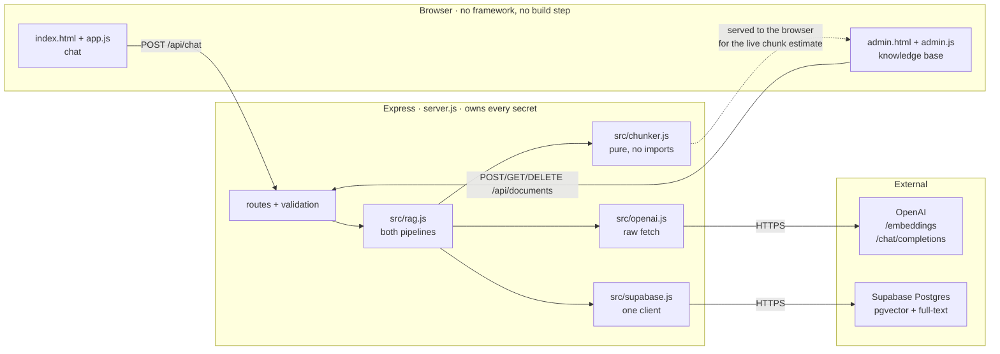
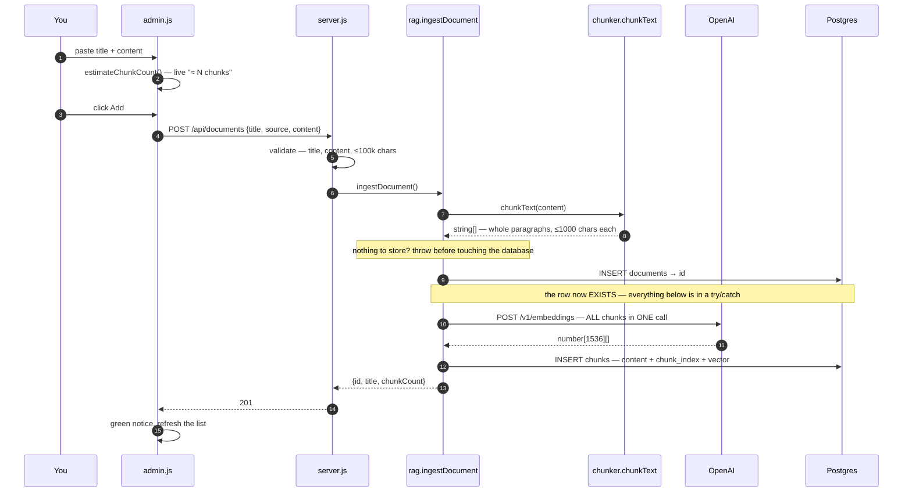
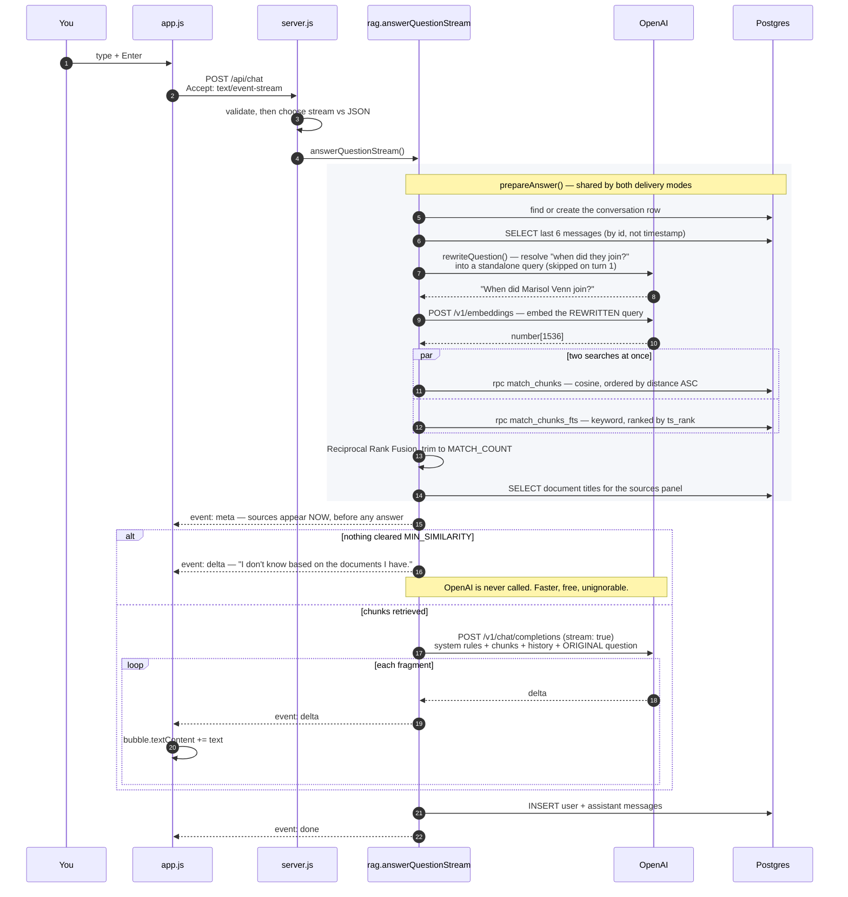
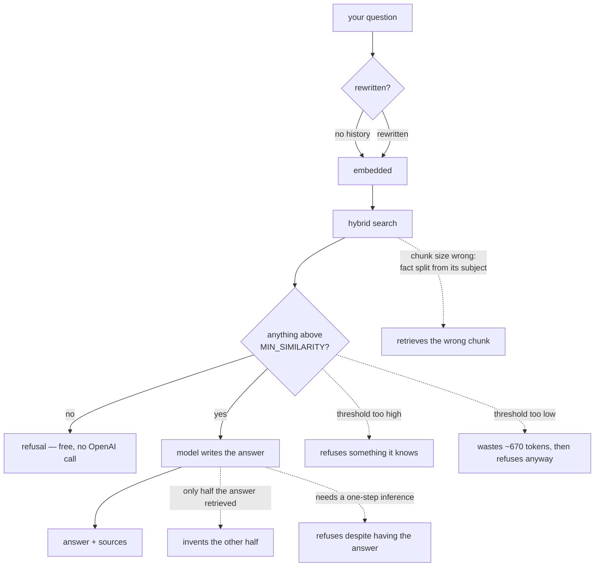

# Flow — how a request actually travels through this code

> **What this file is.** `architecture.md` § 3 has the *original MVP design*.
> This file has the **flow as built**, including the five post-MVP additions
> (D-015 hybrid search, D-016 query rewriting, D-017 prompt wording, D-018
> paragraph-aware chunking, D-019 streaming).
>
> Every box names the file and function that does the work, so you can read the
> diagram with the source open beside it.
>
> Last updated: 2026-09-20

---

## 1. The big picture

Three processes. The browser never talks to OpenAI or Supabase — that is the
only thing keeping your API key out of the page source (`risks.md` § R-1).

**That dotted line is not a mistake.** `chunker.js` is pure — no imports, no
I/O — so the identical file runs in Node *and* in the browser. The admin page's
live "≈ 3 chunks" estimate uses the server's own constants rather than a copy
that would drift (D-018, `server.js` serves it at `/chunker.js`).

---

## 2. Adding a document — the ingest pipeline

**You paste text into `/admin.html` and press Add.**

**The `catch` is the part worth reading.** If embedding fails after the
`documents` row exists, you are left with a document that shows in the list,
has zero chunks, can never be retrieved, and explains nothing. So the catch
deletes the row and rethrows. Not a transaction — `supabase-js` speaks HTTP, so
there is no `BEGIN`/`COMMIT` to wrap it in (`risks.md` § R-7).

---

## 3. Asking a question — the query pipeline

**You type a question on `/` and press Enter.** This is the one to understand.

### The same thing in words

1. **You press Enter.** `app.js` posts your question with
   `Accept: text/event-stream`. Without that header the same route returns one
   JSON body instead — which is what `curl` gets (D-019).
2. **Express validates** the message and picks a delivery mode. Everything
   after this is `src/rag.js`; the route has no business logic in it.
3. **The conversation row** is found, or created on your first message.
4. **The last 6 messages** are loaded. The model is stateless, so this array is
   re-sent and re-billed every single turn — which is why it is capped (D-011).
5. **Your question is rewritten into a standalone query** if there is history
   to resolve it against. "When did they join?" becomes "When did Marisol Venn
   join?" — because *retrieval never sees the conversation*, only the generator
   does (D-016). Skipped entirely on the first message.
6. **The rewritten query is embedded** — by the same function, reading the same
   env var, that embedded your documents. Different models produce vectors in
   unrelated coordinate spaces, and comparing them yields plausible numbers
   that mean nothing while erroring not at all (D-004, `risks.md` § R-3).
7. **Two searches run in parallel.** Cosine similarity finds things that *mean*
   the same; Postgres full-text finds exact tokens like `NL-220` that
   embeddings are bad at. Results are merged by **rank**, not score — the two
   numbers have no common scale (D-015).
8. **Document titles are fetched** so each source reads *"Northwind Labs
   Operations Handbook · 0.588"* rather than *"document 25"*.
9. **`meta` is sent.** The sources panel appears here, **before the model has
   written anything.** You can read what it was given while it decides what to
   make of it.
10. **Either** nothing cleared the threshold — the refusal is returned and
    **OpenAI is never called** (D-008) — **or** the prompt is assembled and
    streamed. Note the prompt carries your *original* words, not the rewrite;
    an answer addressing a silently reworded question reads wrong.
11. **Both messages are saved**, including refusals, so a later "what about the
    second one?" has an unbroken transcript to resolve against.

---

## 4. Where the answer can go wrong

Each of these is measured in [`notes.md`](./notes.md). They are worth knowing
as a map of *which* step to suspect.

**The rule of thumb Phase 5 produced:** open the sources panel first.

- **Wrong answer, sources look irrelevant** → a *retrieval* problem. Chunking,
  threshold, or the search itself.
- **Wrong answer, sources contain the right text** → a *generation* problem.
  Prompt wording, or the model. No amount of retrieval work fixes it.

That single distinction is what the sources panel exists to make visible, and
it is why D-012 calls it a feature rather than a debug toggle.

---

## 5. The seven routes

| Method | Route | Does | Lives in |
|---|---|---|---|
| `GET` | `/` | chat page | `public/index.html` |
| `GET` | `/admin.html` | knowledge base page | `public/admin.html` |
| `GET` | `/chunker.js` | the pure chunker, for the live estimate | `src/chunker.js` |
| `POST` | `/api/documents` | chunk → embed → store | `rag.ingestDocument` |
| `GET` | `/api/documents` | list with chunk counts | `rag.listDocuments` |
| `GET` | `/api/documents/:id/chunks` | expand a row to show its chunks | `rag.getChunks` |
| `DELETE` | `/api/documents/:id` | delete; chunks cascade | `rag.deleteDocument` |
| `POST` | `/api/chat` | ask — SSE or JSON | `rag.answerQuestionStream` / `answerQuestion` |
| `GET` | `/api/conversations/:id/messages` | reload a transcript | `rag.getMessages` |

---

## 6. The knobs, and what each one moves

All named constants at the top of their module, so Phase 5 could find them.

| Constant | Value | File | Moves |
|---|---|---|---|
| `CHUNK_SIZE` | 1000 | `chunker.js` | retrieval quality, more than anything else |
| `CHUNK_OVERLAP` | 150 | `chunker.js` | whether a split fact survives somewhere |
| `MATCH_COUNT` | 5 | `rag.js` | cost per question, and whether a whole answer is present |
| `MIN_SIMILARITY` | 0.25 | `rag.js` | cost — **not** correctness. Measured, not guessed |
| `MAX_HISTORY` | 6 | `rag.js` | cost growth over a long conversation |
| `CANDIDATE_COUNT` | 10 | `rag.js` | how much each search contributes before fusion |
| `RRF_K` | 60 | `rag.js` | how sharply rank 1 dominates in the fusion |

**Changing either chunker constant requires re-ingesting every document.**
Stored chunks are not touched by a code change.
