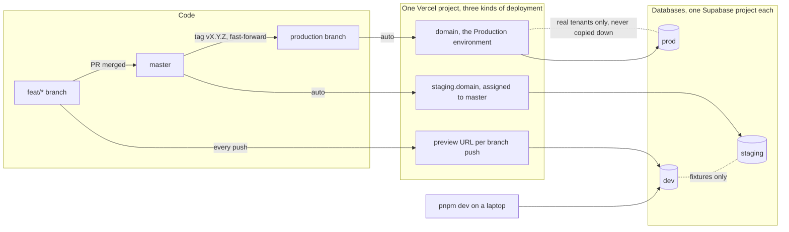
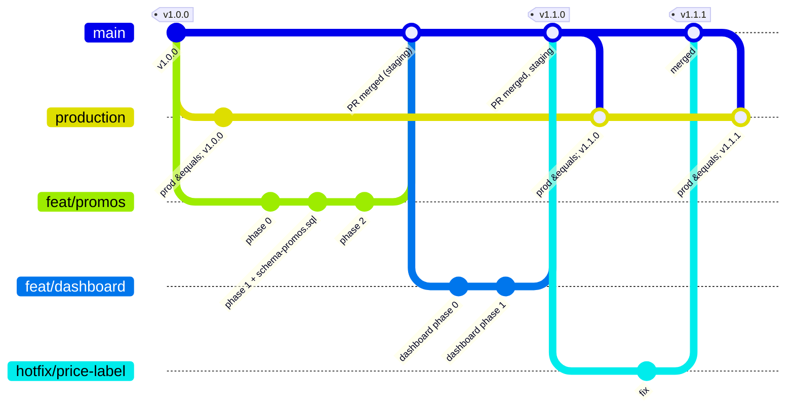
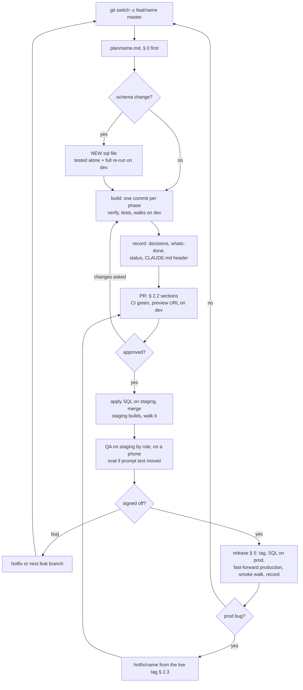

# release-process.md — developing after production

> How to keep changing this project once real tenants are on a public URL.
> It answers four questions: which environments exist, how git is used,
> how each environment is deployed, and what a production release is.
> Everything here follows from one fact about this repo: **the database is
> changed by pasting numbered SQL files into the Supabase SQL editor, in
> order, by a person** (`packages/db/README.md` § The schema). There is no
> migration tool, and the files are the record of what ran. Most of the
> process exists to keep that safe when there is data that matters.
>
> Written 2026-10-21, before the first deploy. Vercel is assumed, because
> `clientIp()` trusts the first `X-Forwarded-For` entry and that is correct
> on Vercel only (R-57). Another host changes § 4 and `lib/rate-limit.ts`.

---

## 0. The rules this process protects

1. **A schema file that reached production is never edited again.** A
   change is a NEW file, the 45th, guarded so the whole set re-runs in
   order (traps 20 and 25). The files are the migration history.
2. **Every environment is its own Supabase project, its own OpenAI key, its
   own signing key.** Nothing is shared across environments: not a
   database, not `TENANT_SIGNING_JWK` (a master key, R-19), not the
   `payment-proofs` bucket.
3. **Production data never comes down.** No dump of prod into staging or a
   laptop: `bookings`, `stays`, `messages` and `payments` hold guest names,
   phones, emails and proofs under the Data Privacy Act (RA 10173, D-129).
   Lower environments run on `fixtures/` and `sample-documents/`.
4. **`master` is always deployable.** Nothing merges that fails
   `pnpm typecheck`, `pnpm test` and `verify` against a database that has
   the branch's SQL applied.
5. **A schema change is applied BEFORE the code that needs it, and it must
   not break the code that is running.** A Vercel deploy and a SQL paste
   are not one transaction. For the minutes (or days) between them, the old
   code runs against the new schema. So a change is additive first
   (a column with a default, a new function, a new policy), and the
   removal is a later release.
6. **The record is kept per environment.** `whats-done.md` says which file
   was applied where and when, with the counts `verify` printed there.
   "Applied" without an environment name is not applied.

---

## 1. Environments: which ones, and why



| Environment | Who uses it | Database | Code | Data |
|---|---|---|---|---|
| **local** | one developer, `pnpm dev` | the **dev** Supabase project (Free; shared by developers and branch previews) | the branch on their machine | fixtures only |
| **staging** (QA) | QA, the product owner, the user's own walks | the **staging** Supabase project (Free) | every merge to `master`, automatically (a Vercel preview with the staging domain and staging's variables, § 4.1) | fixtures: `villa`, `northwind`, `harbor`, an `alteza`-like tenant, throwaway members |
| **production** | tenants and their guests | the **prod** Supabase project (Pro, its own organization) | the `production` branch, moved by hand at a release | real tenants only |

**Do you need both a dev and a QA environment?** You need two non-production
**databases**, not necessarily two deployed sites.

- A developer writing the 45th SQL file pastes it, finds a mistake, drops a
  function, pastes again. If that database is also what QA is testing
  against, QA is testing a moving target, and a half-applied trigger can
  refuse every booking on their screen. So in-progress schema work needs a
  database nobody else depends on: **dev**.
- QA needs a database that changes only when something merges, so a bug
  they find is reproducible tomorrow: **staging**.
- A deployed **dev site** is optional. Vercel builds a preview URL for every
  pull request anyway (§ 4.2), and those previews point at the dev
  database. That covers "look at my branch in a browser" without a third
  site.

For a solo developer the answer is the same, because the two jobs (break
things, verify things) are still separate; the dev Supabase project is a
free-tier one.

**What the plans allow (checked 2026-10-21, § 8):** a Supabase Free
organization holds at most 2 active projects, and a Free project is
PAUSED after a week without traffic. So dev and staging fit in one Free
organization, and a dev database that CI has not touched for a week will
fail CI until someone restores it from the dashboard. Production is a Pro
organization ($25/month, which includes one Micro instance; a second
project in the same organization pays its own compute). Keep prod in an
organization of its own.

**What staging holds that production never will:** the test tenants
`northwind` and `harbor` (hard-deleted from the one database on
2026-10-20), rebuilt from `fixtures/` with the loaders in CLAUDE.md. This is
what makes `pnpm eval` and both isolation suites runnable again. Staging is
where the prompt battery runs from now on (rule 1), on the staging OpenAI
key with its own spend cap. Give staging's test tenants a `dpa_signed_on`
date so their bookings can be switched on (D-130).

---

## 2. Git

### 2.1 Branches



In words (`main` above is this repo's `master`; the merges into
`production` are fast-forwards, drawn as merges only because the diagram
has no other way to show the branch moving):

```
feat/<name>  ──PR──▶  master  ──(auto)──▶ staging
                         │
                         └── tag vX.Y.Z ──(fast-forward)──▶ production ──(auto)──▶ prod
hotfix/<name> ──PR──▶ master, then the same tag and fast-forward
```

- **`feat/<name>`**: one change, one plan file in `plan/`, one commit per
  phase, as every feature so far was built (`feat/audit-log`,
  `feat/rate-limit`, ...). Short-lived: days, not weeks. Rebased on
  `master` before the PR.
- **`master`**: the integration branch. What is on staging. Protected:
  pull requests only, CI green, no force-push.
- **`production`**: what is on the public URL. It only ever moves by
  fast-forward to a tag on `master`, so `production` is always an ancestor
  of `master` and `git log production..master` is exactly "what is on
  staging and not yet released".
- **Tags `vX.Y.Z`**: every production release. Patch for a fix, minor for
  a feature, major for a schema change that is not backward compatible
  (§ 3.3). The tag is what a rollback points back to.

Why not the classic `develop` / `release/*` / `main` git flow: this
project's branches already merge by fast-forward after one feature, and
the risky part of a release is the SQL, not the code. A long-lived
`develop` branch adds merges to resolve and gives nothing the tag does
not. Two permanent branches is the smallest shape where "what is on
staging" and "what is on production" are both a branch name Vercel can
deploy.

### 2.2 A pull request

The PR description carries, in this order:

1. **The decision**: the `D-nnn` it adds or amends, in a line.
2. **Schema**: the new SQL file's name, or "none". If there is one: what
   it adds, what it replaces (and the marker the replacement is guarded
   on), and the line "backward compatible with the running code: yes/no".
3. **The prompt**: "no prompt or tool text changed" with the three
   baselines diffed, or the battery's numbers (`pnpm eval` on staging,
   printed as `original 9/10 · tool 9/9 · ...`), every `why:` read.
4. **The numbers**: verify, rooms, the web tests, the walks that apply,
   as observed on the dev database with the branch's SQL applied.
5. **Env**: any new variable, added to `.env.example` and to both Vercel
   projects BEFORE merge (a build that reads a missing one fails fast,
   D-023).

Review reads `decisions.md` and `whats-done.md` in the diff as carefully
as the code: they are the only place the measured values live.

### 2.3 Hotfix

A production bug that cannot wait for what is on staging:

1. Branch from the tag that is live: `git switch -c hotfix/<name> vX.Y.Z`.
2. Fix, test, PR to `master`. If `master` has moved on, the fix merges
   into `master` first (so it is never lost), then is cherry-picked onto a
   branch from the tag for the release.
3. Tag `vX.Y.(Z+1)` on the cherry-picked commit, fast-forward
   `production` to it (§ 5).

A hotfix with a schema change is not a hotfix; it is a release.

---

## 3. The database: changing it with data in it

### 3.1 Writing the change

- One new file, `packages/db/sql/schema-<name>.sql`, the next number in
  CLAUDE.md's list. Never a change to an existing file, except to ADD a
  guard that lets it re-run.
- `set search_path = ''` on every function and trigger, every name
  qualified (trap 19).
- Replacing a function an older file defines: guard the older definition
  on this file's marker, usually `to_regclass('public.<new table>')` or a
  check on `pg_proc`, so re-running the whole set in order still ends on
  the new definition (traps 20 and 25).
- A new table a token must read gets its policies in the same file
  (R-22), and `verify.mjs` gets the positive twin (trap 12).
- A new table staff write gets its line in `audit_row()` and the attach
  list (D-138).
- Test it twice on dev: once applied alone on top of the current set, and
  once by re-running the WHOLE set in order on an empty dev schema. The
  second run is what catches trap 25.

### 3.2 Applying it, per environment

The same bytes, in the same order, in three places, by hand, recorded.
The file travels with the code but always lands one step ahead of it:

```mermaid
flowchart LR
  W[write schema-name.sql<br/>the 45th file] --> D1[paste on DEV<br/>alone, on the current set]
  D1 --> D2[re-run the WHOLE set<br/>on an empty dev schema]
  D2 --> V1[verify on dev]
  V1 --> PR[PR: file named,<br/>backward compatible: yes/no]
  PR --> S1[paste on STAGING]
  S1 --> M[merge to master<br/>staging builds]
  M --> V2[verify + walks on staging]
  V2 --> QA[QA sign-off]
  QA --> T[tag vX.Y.Z]
  T --> P1[paste on PROD<br/>from the tagged commit]
  P1 --> P2[fast-forward production<br/>prod builds]
  P2 --> SW[smoke walk]
  SW --> R[record: applied on prod, date]
```



| Step | dev | staging | prod |
|---|---|---|---|
| Who | the developer | whoever merges the PR | the release owner |
| When | while building | at merge, before Vercel finishes the staging build | at the release, before `production` moves |
| How | Supabase SQL editor, the file pasted whole | same | same, from the tagged commit, not from a working tree |
| Then | `verify` | `verify`, the walks the PR named | the smoke walk (§ 5.4) |
| Record | the PR description | `whats-done.md`: "applied on staging <date>, verify N/N" | `whats-done.md`: "applied on prod <date>", `status.md`'s release line |

If "before the build finishes" is too tight on staging, pause the Vercel
deployment or apply the SQL first and merge second. The order matters
only when the change is not backward compatible, and § 0 rule 5 says it
should be.

An optional, cheap safety: a table `schema_applied(file text primary key,
applied_at timestamptz default now())` with one `insert ... on conflict do
nothing` line at the END of every file from the 45th on. Then "which
files has prod had?" is a query, not a search of `whats-done.md`. It is
not required by anything that exists today; add it the first time two
people apply files.

### 3.3 Backward compatibility, in practice

Additive changes ship in one release and need no window:

- a new table, a new column with a default or nullable, a new function,
  a new policy, a new trigger that refuses a NEW kind of row.

Changes that break running code need two releases, or a window:

- renaming or dropping a column or function the deployed code calls;
- a trigger that starts refusing writes the deployed code makes;
- a function whose return type changes (`unit_quote()` did this once,
  trap 20).

Two releases: release N adds the new shape and the code that writes both;
release N+1 drops the old one. If that is not worth it, a **window**: the
tenants are told, `production` is moved and the SQL applied within
minutes of each other, with the smoke walk between. A major version
number marks it.

### 3.4 Rolling the database back

You do not. SQL is forward-only here: the undo of a bad file is a new
file that reverses it, applied the same way, recorded the same way. This
is the real reason for rule 5: when the code is rolled back (§ 5.6), the
schema stays at the newer version, and the older code must still run on
it.

Supabase's daily backups are for disaster, not for releases: restoring
one loses every booking since. They exist on Pro and above only (7 days
of daily backups on Pro); a Free project has none, which is one more
reason prod is Pro. Point-in-time recovery is a paid add-on on top of
Pro and needs at least the Small compute size.

---

## 4. Deploying each environment

### 4.1 One Vercel project, or two

Vercel deploys every push: a push to the project's **production branch**
is a production deployment, a push to any other branch is a preview
deployment with its own URL. The production branch is set per project
(Settings → Environments → Production → Branch Tracking). Both shapes
below are supported; the first is the one Vercel's own docs describe
("multiple preview phases"), the second needs one extra setting.

**Shape A, one project (recommended):**

| Branch | Environment on Vercel | Domain | Variables (§ 4.3) |
|---|---|---|---|
| `production` | Production | `<domain>` | Production |
| `master` | Preview, branch `master` | `staging.<domain>`, assigned to the branch | Preview, **scoped to branch `master`**: staging's |
| any other branch, every PR | Preview | the generated URL | Preview, unscoped: dev's |

A domain can be assigned to a Git branch, and a Preview variable can be
scoped to one branch, overriding the unscoped Preview value of the same
name. That is exactly "master is staging, everything else is dev".
Store every secret as the **Secret** type (write-only after saving), so
a member with project access cannot read prod's values back.

**Shape B, two projects on the same repository:** `rag-staging`
(production branch `master`) and `rag-prod` (production branch
`production`). Supported, with one catch: BOTH projects build a preview
of every branch, because previews are per project. `vercel.json` cannot
switch that off for one project only, since the file is the same for
both. The per-project switch is the **Ignored Build Step** on
`rag-prod` (Settings → Git), with "Automatically expose System
Environment Variables" on:

```sh
if [ "$VERCEL_ENV" = "production" ]; then exit 1; else exit 0; fi
```

Exit 0 skips the build; 1 builds. Shape B keeps the two sets of secrets
in two projects, which some teams want for access control. Shape A is
fewer moving parts and is what the rest of this file assumes; where it
says `rag-prod`, read "the production environment".

Either way, prod is a **Pro** team: Vercel's Hobby plan forbids
commercial use, and a Hobby team cannot deploy a private repository that
lives in a GitHub organization. Custom Environments (a named "staging"
environment instead of the branch convention above) are a Pro feature
too, and an alternative to Shape A on Pro.

### 4.2 Pull-request previews

Every push to a branch other than `production` and `master` gets a
preview URL. It runs against the **dev** database
(the unscoped Preview variables point there, not at staging), so a
preview that needs the branch's SQL works as soon as the developer has
applied it on dev, and a broken file never reaches QA's database. A
reviewer opens the preview, logs in with a dev member, walks the screen.

### 4.3 Environment variables

| Variable | dev (local + previews) | staging | prod | Notes |
|---|---|---|---|---|
| `OPENAI_API_KEY` | key A, low cap | key B, cap for the battery | key C, the real cap | R-1: three keys, three caps, so a runaway battery cannot spend prod's |
| `OPENAI_CHAT_MODEL`, `OPENAI_EMBEDDING_MODEL` | same everywhere | same | same | the embedding model is coupled to every stored vector (traps 1 and 3); it changes nowhere without re-embedding everywhere |
| `OPENAI_TRANSCRIBE_MODEL`, `OPENAI_TTS_MODEL` | optional | optional | optional | D-134 |
| `SUPABASE_URL`, `SUPABASE_PUBLISHABLE_KEY` | dev project | staging project | prod project | |
| `TENANT_SIGNING_JWK` | its own | its own | its own | imported as the STANDBY signing key in THAT project's dashboard (D-039); never the same key twice |
| `ADMIN_COOKIE_SECRET` | its own | its own | its own | rotating it logs everyone out (R-44) |
| `VAPID_PUBLIC_KEY`, `VAPID_PRIVATE_JWK`, `VAPID_SUBJECT` | optional | its own pair | its own pair | a new pair orphans every device (D-116) |
| `SUPABASE_SERVICE_ROLE_KEY` | a laptop's `.env` and CI, for `tools/` | CI only | **the release owner's shell, never Vercel** | rule 2; `next build` passes without it, measured |

The web app on Vercel holds no service-role key in any environment. The
tools that need it (`verify`, `tenant:*`, `member:*`, `super:*`,
`retention`, `storage-orphans`) run from a shell or a CI job that has it
for that environment alone.

The signing key: each Supabase project has its own JWT signing keys
page. Our key is imported there as the one **standby** key, then
rotated to current (D-039; the dashboard holds one standby key at a
time, R-19). The import is "Import an existing key" in the standby-key
dialog, pasted as the raw JWK object. Three projects, three imports,
three different keys.

### 4.4 CI, on every pull request and on `master`

A GitHub Actions workflow (none exists yet; this is its spec):

1. `pnpm install --frozen-lockfile`
2. `pnpm typecheck` (the service-import check runs first)
3. `pnpm test` (chunker, rag, bookings, web: no database, no key)
4. `pnpm build` with `SUPABASE_SERVICE_ROLE_KEY=` EMPTY (trap 13), then
   the bundle grep of rule 2 over `apps/web/.next/static/`: it must print
   nothing.
5. `pnpm audit --prod` (R-58): fail on high, on the commit that will be
   deployed.
6. `pnpm --filter @rag/db verify` against the **dev** database, with its
   service key as a CI secret. It creates and sweeps its own rows.
7. The three prompt baselines diffed (`prompt-snapshot` against
   `plan/baseline/`), against dev with the test tenants loaded.

Not in CI: `pnpm eval` (it spends OpenAI money and takes minutes) and the
browser walks (they need `pnpm dev` and a display). Both run by hand, on
staging, when the PR says they must (rule 1: any edit to `buildPrompt()`,
`language.ts`, `dates.ts`, a tool definition, or a baseline).

### 4.5 The scheduled jobs (R-59)

Per environment, daily, from a GitHub Actions cron with that environment's
service key (a Vercel cron hitting a protected route is the alternative;
the Action needs no new route, and it needs no Vercel plan: Vercel's own
cron runs at most once a day with an hour of slack on Hobby, and per
minute on Pro):

```
pnpm --filter @rag/db retention -- --remove
pnpm --filter @rag/bookings storage-orphans -- --expired --remove
```

and a call of `expire_due_stays()` so `expired` is stored on the day, not
when staff next look. The first production run's counts go in
`whats-done.md`.

---

## 5. A production release

### 5.1 Who and when

One person owns a release, start to finish. Releases are small and
frequent: what is on staging and signed off goes out, usually within the
week, on a day someone is around for the hour after. Not on a Friday
afternoon, not during a tenant's check-in rush (see each tenant's slots).

### 5.2 Before the tag

- [ ] `git log production..master` read end to end: every commit is
      meant to ship.
- [ ] Every SQL file in that range is applied on staging and
      `whats-done.md` says so.
- [ ] QA sign-off on staging: the screens the range touched, by role
      (staff, admin, owner, super user), on a phone width too.
- [ ] If the range touched prompt text or a tool: `pnpm eval` on staging
      at the expected numbers, every `why:` read; the three baselines
      byte-identical or deliberately replaced.
- [ ] The isolation suites on staging, both ways (rule 6), if the range
      touched a query, a policy or a token.
- [ ] CI green on the `master` commit to be tagged, including the bundle
      grep and `pnpm audit --prod`.
- [ ] New env variables already set on the Production environment.
- [ ] `decisions.md`, `whats-done.md`, `status.md` and CLAUDE.md's
      header updated in the range (they are part of the release).

### 5.3 The release

```mermaid
sequenceDiagram
  actor Owner as Release owner
  participant Git as GitHub
  participant SQL as Supabase SQL editor (prod)
  participant Vercel as Vercel (Production environment)
  participant Site as Public URL

  Owner->>Git: git log production..master, checklist § 5.2
  Owner->>Git: git tag vX.Y.Z, git push origin vX.Y.Z
  Owner->>SQL: paste each new schema file, in order, from the tag
  SQL-->>Owner: rows affected, no error
  Note over Owner,SQL: old code is now running on the new schema (rule 5)
  Owner->>Git: git push origin vX.Y.Z:production (fast-forward)
  Git->>Vercel: production branch moved
  Vercel->>Vercel: next build (no service key)
  Vercel-->>Site: new deployment live
  Owner->>Site: smoke walk § 5.4 (guest, staff, super user, bell, photo)
  alt walk fails
    Owner->>Vercel: Instant Rollback, or push the previous tag to production
    Note over Owner,SQL: the schema stays; re-release as a new patch tag
  else walk passes
    Owner->>Git: GitHub release on the tag; status.md and whats-done.md updated
  end
```

```sh
git switch master && git pull --ff-only
git tag -a vX.Y.Z -m "vX.Y.Z: <one line, the D-nnn numbers>"
git push origin vX.Y.Z
```

Then, in this order:

1. **SQL on prod**, from the tagged commit's files, in file order, in
   the Supabase SQL editor of the prod project. Read each file once more
   before pasting: it is the only review prod gets.
2. **Move `production`**: `git push origin vX.Y.Z:production` (a
   fast-forward; if it is refused, `production` has a commit `master`
   lacks, and that is a bug in the process to fix before forcing
   anything).
3. **Watch the Vercel build** finish for the Production environment.
4. **Smoke walk** (§ 5.4).
5. **Record** (§ 5.5).

For a release that is not backward compatible (§ 3.3): steps 1 and 2 are
minutes apart, inside an announced window, and the smoke walk is done
with a phone in hand.

### 5.4 The smoke walk, on the public URL, every release

Five minutes, as a guest and as staff, on a real tenant:

- the chat answers a documents question, refuses an absent one, and a
  date question runs the tool (the "Checked availability" line);
- `/t/<slug>/book` quotes a stay; the request is NOT submitted on prod
  unless a test tenant exists there;
- staff login, the dashboard, the bookings list, one transcript;
- `/platform` login as a super user;
- the Notifications bell polls (the Network tab shows `/admin/attention`
  every 30 s);
- a room photo loads from Storage with the one-year cache header (D-141).

Anything wrong here is a rollback first (§ 5.6) and a diagnosis second.

### 5.5 The record

- `status.md`: one line under "Next up": "**vX.Y.Z released <date>**:
  SQL files N..M applied on prod, smoke walk 6/6, <anything observed>".
- `whats-done.md`: what shipped, why, the observed values from prod (the
  build time, the first poll, the counts a sweep printed).
- The GitHub release on the tag, with the PR descriptions of the range.

### 5.6 Rollback

Code: `git push --force origin vX.Y.(Z-1):production`, or Vercel's
"Instant Rollback" to the previous production deployment. Either is
seconds. Then `whats-done.md` says why. Instant Rollback exists on every
plan; Hobby can go back one deployment only, Pro to any earlier
production deployment. It does NOT revert environment variables changed
in the meantime, so a release that changed a variable rolls that back by
hand.

Schema: stays (§ 3.4). The older code runs on the newer schema, which
rule 5 guarantees for one release. A rolled-back release is re-released
as a new patch tag, never by re-pushing the same tag.

---

## 6. Day to day, in one page



```
1. Branch:    git switch -c feat/<name> master
2. Plan:      plan/<name>.md, § 0 first, as every feature so far
3. Schema:    a NEW file, tested alone and in the full re-run, on dev
4. Build:     one commit per phase; verify, tests, walks on dev
5. Record:    decisions.md, whats-done.md, status.md, CLAUDE.md header
6. PR:        the five sections of § 2.2; CI green; a preview URL on dev
7. Merge:     apply the SQL on staging, merge, staging builds, walk it there
8. QA:        on staging, by role, on a phone; eval if prompt text moved
9. Release:   § 5: tag, SQL on prod, fast-forward production, smoke walk, record
10. Hotfix:   § 2.3, from the live tag
```

---

## 7. Before the FIRST release only

The things the record says are owed before a public URL, so this process
has something to run on. Each is a risk entry with its own what-to-do:

- security headers in `next.config.mjs` (R-55) and an `Origin` check in
  `withRoute()` (R-56);
- `pnpm update next` and friends (R-58);
- the scheduled jobs (R-59, § 4.5);
- a lawyer's text in `lib/legal.ts` and each tenant's `dpa_signed_on`
  (R-60);
- in the prod Supabase dashboard: custom SMTP (every plan), the auth
  rate limits, leaked-password protection (Pro and above), and MFA
  enforced on the Supabase **organization** (Pro and above, owners only),
  so every person who can open the dashboard has MFA; the buckets
  checked public/private as designed (R-61);
- MFA for the app's own super users (`/platform`) does NOT exist in the
  code (R-43): Supabase Auth offers TOTP MFA, but the enrol and
  challenge screens would be a feature to build. Until then a super
  user's password is the whole wall, and there should be as few of them
  as possible;
- `TENANT_SIGNING_JWK` and `ADMIN_COOKIE_SECRET` fresh for prod (never a
  key that was ever in a chat or `scratch/`), and the signing key imported
  as the standby key in the prod project (D-039, R-19);
- staging built from `fixtures/` so `pnpm eval` and both isolation suites
  run again, and run once, green, before the tag (R-61's last paragraph:
  deploying without the `leak-*` cases is deploying R-11 untested).

---

## 8. Checked against Vercel and Supabase, 2026-10-21

Every claim this file makes about the two platforms, read against their
own documentation on that date. "Yes" means documented as written;
"yes, with a condition" means it works but not for free or not without a
setting; "no" means the file was corrected. Plans and prices change;
re-read the two pricing pages before the first deploy.

| Claim in this file | Supported? | Condition, or what changed | Source |
|---|---|---|---|
| A push to the production branch deploys production; a push to any other branch makes a preview with its own URL | yes | | [Deploying Git repositories](https://vercel.com/docs/git) |
| The production branch is chosen per project (`production` instead of `master`) | yes | Settings → Environments → Production → Branch Tracking | [Deploying Git repositories](https://vercel.com/docs/git#production-branch) |
| A domain can be assigned to a Git branch (`staging.<domain>` on `master`), with branch-scoped Preview variables | yes | Vercel calls this "multiple preview phases" | [Deploying Git repositories](https://vercel.com/docs/git#multiple-preview-phases), [Environment variables](https://vercel.com/docs/environment-variables#preview-environment-variables) |
| Variables are scoped to Production / Preview / Development, and a Preview variable can be scoped to one branch | yes | branch-scoped values override the unscoped ones of the same name | [Environment variables](https://vercel.com/docs/environment-variables) |
| Two projects can be connected to the same repository | yes | both build previews of every branch; stop one with the Ignored Build Step (exit 0 skips, 1 builds), not `vercel.json` | [Projects](https://vercel.com/docs/projects), [Ignored Build Step](https://vercel.com/kb/guide/how-do-i-use-the-ignored-build-step-field-on-vercel) |
| A named "staging" environment (Custom Environments) | yes, with a condition | Pro plan | [Deploying Git repositories](https://vercel.com/docs/git#using-custom-environments) |
| Production on Vercel for paying tenants | yes, with a condition | Hobby forbids commercial use and cannot deploy a private repository in a GitHub organization; prod is a Pro team | [Fair use guidelines](https://vercel.com/docs/limits/fair-use-policy), [Deploying Git repositories](https://vercel.com/docs/git#using-hobby-teams) |
| Instant Rollback to the previous deployment | yes | every plan; Hobby one step back only, Pro any earlier production deployment; env-var changes are not reverted | [Instant Rollback](https://vercel.com/docs/instant-rollback) |
| Vercel overwrites `X-Forwarded-For` with the caller's address (R-57) | yes | Enterprise can buy a trusted-proxy exception; `x-real-ip` is the same value | [Request headers](https://vercel.com/docs/headers/request-headers) |
| The daily sweeps as a Vercel cron (the alternative to GitHub Actions) | yes, with a condition | Hobby: once a day, an hour of slack; Pro: per minute | [Cron usage and pricing](https://vercel.com/docs/cron-jobs/usage-and-pricing) |
| Dev and staging as free Supabase projects | yes, with a condition | 2 active projects per Free organization; paused after 7 days idle; no backups | [Supabase pricing](https://supabase.com/pricing) |
| Daily backups on prod | yes, with a condition | Pro and above (7 days on Pro); Free has none; PITR is an add-on needing Small compute and replaces daily backups | [Backups](https://supabase.com/docs/guides/platform/backups), [Supabase pricing](https://supabase.com/pricing) |
| Our own JWK imported as the standby signing key, then rotated (D-039) | yes | one standby key at a time; "Import an existing key" in the standby dialog; old keys stay valid until revoked | [JWT signing keys](https://supabase.com/docs/guides/auth/signing-keys) |
| Custom SMTP | yes | every plan | [Custom SMTP](https://supabase.com/docs/guides/auth/auth-smtp) |
| Leaked-password protection | yes, with a condition | Pro and above | [Password security](https://supabase.com/docs/guides/auth/password-security) |
| "MFA for every super-user account" (the file's first draft) | **no, as written** | the app has no MFA (R-43). What exists: MFA enforced on the Supabase organization, Pro and above, owners only; app-level MFA would be built on Supabase Auth's TOTP API | [Org MFA enforcement](https://supabase.com/docs/guides/platform/mfa/org-mfa-enforcement) |
| Supabase Branching as a dev/preview database per PR | not for this repo | it builds a branch from the migrations in the repository; our 44 files are pasted by hand, not a `supabase/migrations` history, so Branching does not apply unless the files are converted | [Branching](https://supabase.com/docs/guides/deployment/branching) |
| Pasting SQL files in the SQL editor, public and private buckets, auth rate limits in the dashboard | yes | what the project does today | `packages/db/README.md`, R-61 |

Two things in this file are GitHub's, not Vercel's or Supabase's, and
need no check: branch protection on `master` and `production`, and a
scheduled GitHub Actions workflow per environment.
